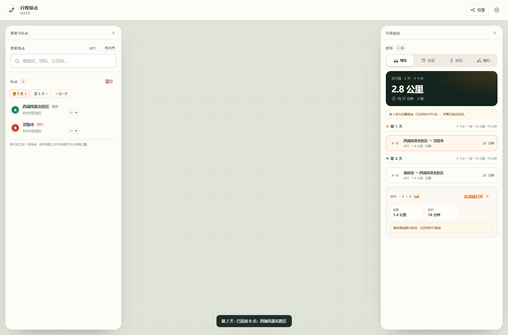
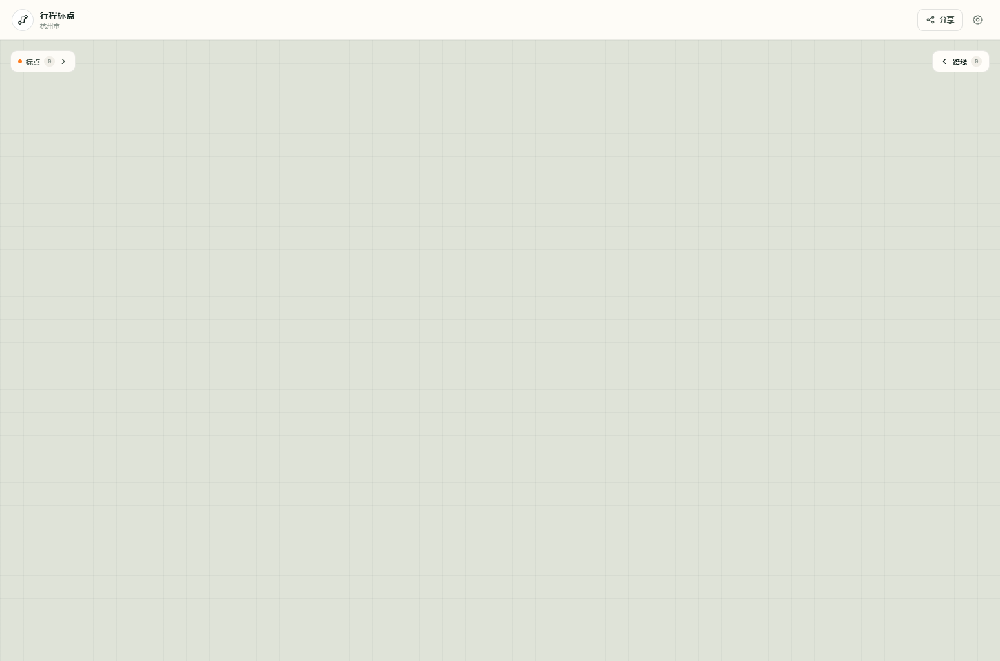
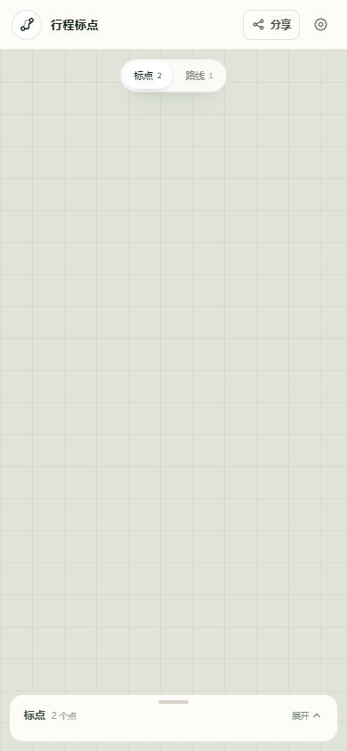
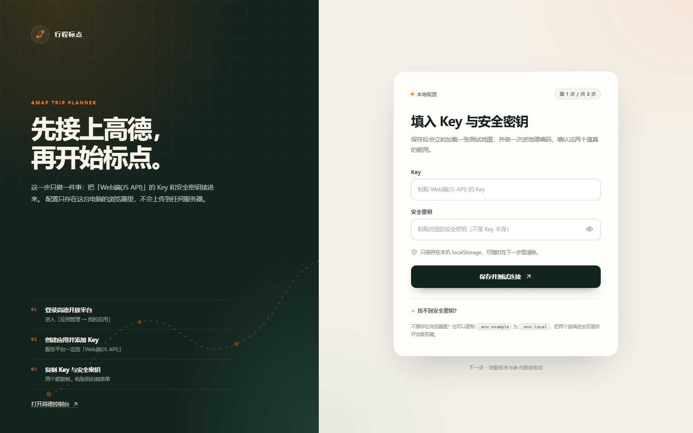
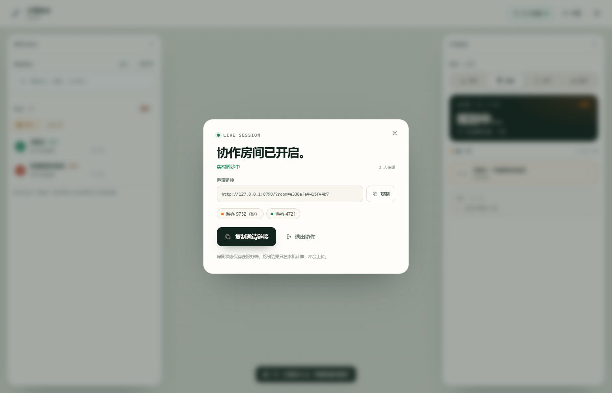
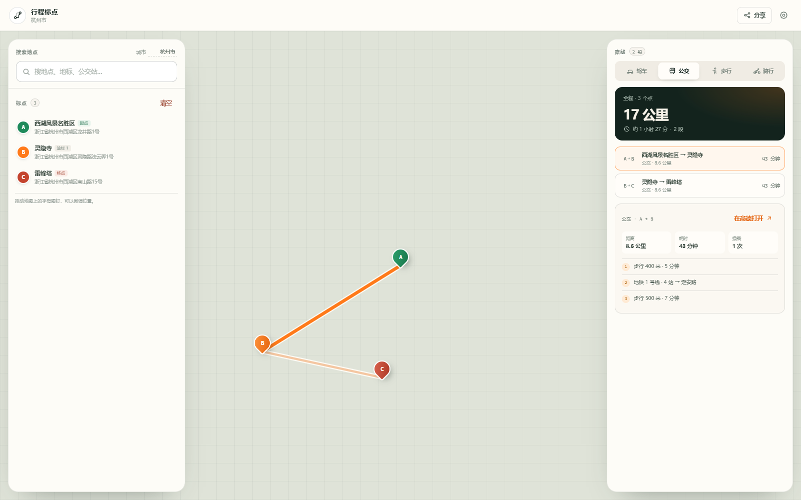

# 行程标点

基于高德地图 JS API 2.0 的行程规划小工具：在地图上精确标点，按天分组，自动串联多点路线，支持驾车、公交、步行、骑行四种方式。景区内道路不可达时会自动降级为步行或直线估算，并在界面上明确标注；支持多人实时协作编辑同一份行程。



## 现在能做什么

- 搜索地点，或直接点地图空白处落点；
- 拖动字母图钉微调位置，自动反查地址；
- 点列表支持上移、下移、删除、清空和定位；
- **按天分组**：第 1 天 / 第 2 天 / 加一天，每天独立规划，不会跨天连线；
- 每个点可以单独调整所属天数；
- 同一天内相邻两点自动规划一段，多点行程自动串成多段；
- 四种出行方式一键切换：驾车、公交、步行、骑行；
- 公交按段展示步行、地铁/公交线路、换乘次数；
- 景区内驾车不可达或绕行过远时，自动尝试步行；步行也不可用时按直线估算并画虚线，界面标注“估算”；
- 地图上高亮选中的行程段，其余段变淡，不同天使用不同颜色；
- 每段可跳转高德网页版路线规划；
- 自动保存到本机，刷新不丢；
- 生成分享链接，打开即还原标点、天数和出行方式；
- **实时协作**：创建房间、复制邀请链接，多人同时改标点/天数/顺序/出行方式，顶部显示在线成员；
- 桌面左右面板可收起成窄标签，移动端底部抽屉也可收起。





## 运行

```bash
npm install
npm run dev
```

打开终端里显示的地址（默认 http://127.0.0.1:5173/）。

## 配置高德 Key

需要高德开放平台的 **Web端 (JS API)** Key 和对应的**安全密钥**，不是「Web服务」Key。

### 方式一：页面里填（推荐）

首次打开会进入配置引导页：

1. 粘贴 Key；
2. 粘贴安全密钥；
3. 点「保存并进入地图」。

配置只存在本机 `localStorage`，不会上传。保存后会刷新，直接进入地图工作区。



### 方式二：环境变量

```bash
cp .env.example .env.local
```

填入：

```dotenv
VITE_AMAP_KEY=你的Key
VITE_AMAP_SECURITY_CODE=你的安全密钥
```

重启 `npm run dev`。环境变量优先级高于页面里保存的配置。

### 申请入口

高德开放平台 → 应用管理 → 我的应用 → 创建应用 → 添加 Key → 服务平台选 **Web端(JS API)**。

- 控制台：https://console.amap.com/dev/key/app
- 准备文档：https://lbs.amap.com/api/maps-javascript-api/prepare
- 安全密钥说明：https://lbs.amap.com/api/javascript-api-v2/guide/abc/jscode

## 使用说明

1. 搜索地点，或直接点地图落点；
2. 点「+ 加一天」创建第 2 天，新点会落到当前选中的那天；
3. 当天第一个点是起点，最后一个是终点，中间是途经点；
4. 点卡片上的 `D1/D2` 下拉，可以把某个点移到其他天；
5. 每天至少两个点才会串成路线，不同天之间不会互相连接；
6. 点某一段行程，地图上对应路线加粗高亮；
7. 「在高德打开」会打开高德网页版，带着这段的起终点和方式；
8. 顶部「分享」复制只读快照；顶部「协作」创建实时房间，邀请链接打开即可一起改。



## 实时协作

实时协作需要后端 WebSocket 服务，不能只靠静态前端。

### 本地开发

```bash
npm run dev
```

会同时启动 Vite（5173）和协作服务（8787）。页面里的 WebSocket 走同源 `/ws`，由 Vite 代理到 8787。

注意：本地 `127.0.0.1` 的邀请链接只能在同一台电脑打开；要让别人访问，需要部署到公网（见下一节）。

### 协作规则

- 创建房间后，当前行程会作为房间初始状态；
- 拿到邀请链接的人都能进入并编辑，房间链接即权限；
- 同步的是**标点、天数、顺序、城市、出行方式**；
- 路线结果不共享，仍在每个人自己的浏览器里调用高德计算；
- 房间状态由服务端按操作顺序广播，客户端不做本地抢先写入，避免多人同时改时状态分叉；
- 服务端把房间持久化到 `data/rooms.json`，重启后可恢复；
- 目前没有账号体系，也没有评论/光标/权限分级，别把敏感行程放到公开房间。

## 部署到公网

项目自带 `Dockerfile` 和 `render.yaml`，前端静态文件和 WebSocket 在同一个 Node 服务里，部署一个容器即可。

### 方式一：Render

1. 把项目推到 GitHub；
2. Render → New → Blueprint，选择仓库，使用根目录的 `render.yaml`；
3. 部署完成后用 Render 给的域名访问；
4. 页面顶部「协作」创建房间，复制邀请链接发给别人。

Render 免费实例支持 WebSocket，但会休眠、磁盘不持久；要长期保留房间，需要挂持久磁盘或换 Railway/Fly/VPS。

### 方式二：任意 Docker 主机

```bash
docker build -t amap-trip-planner .
docker run -d -p 8080:8080 \
  -v $(pwd)/data:/app/data \
  --name amap-trip \
  amap-trip-planner
```

访问 `http://服务器IP:8080`。生产环境建议放在 Nginx/Caddy 后面并启用 HTTPS，WebSocket 会自动使用 `wss://`。

健康检查：`GET /health`。

## 为什么景区内会显示步行或虚线

高德的驾车/骑行路线规划走的是**道路网**。景区内部大量是园路、步行道、内部通道，驾车会绕出景区甚至直接无结果。

当前处理顺序：

1. 先按你选的出行方式规划；
2. 驾车/骑行失败，或路线距离相对直线距离明显绕远时，自动尝试**步行路线**；
3. 步行也没有结果时，按直线距离估算，画**虚线**，并标注“估算”；
4. 鉴权、配额、网络错误不会降级，会直接显示真实错误，避免用假路线掩盖问题。

估算路线的距离和耗时会在路线卡片里明确标出，不会当成真实道路路线。



## 实现说明

```text
server/
  collab-server.ts             # Node HTTP + WebSocket 房间服务、静态文件、房间持久化
src/
  App.tsx                      # Key 门禁：有配置进主工作区，没有进引导页
  components/
    SetupPage.tsx              # Key 配置引导页
    CollabModal.tsx            # 创建/邀请/退出协作弹窗
    Icons.tsx                  # 内联 SVG 图标
  collab/
    useCollab.ts               # WebSocket 客户端、在线成员、操作广播
  config/
    credentials.ts             # Key 存储、校验、脱敏
    amap.ts                    # SDK 单例加载、错误翻译
  features/
    map/MapCanvas.tsx          # 地图、图钉、拖拽、路线绘制、视野适配
    search/SearchBox.tsx       # POI 搜索、城市切换
    points/PointPanel.tsx      # 标点列表、按天分组、排序、删除
    routes/RoutePanel.tsx      # 方式切换、按天行程、换乘详情
    routes/planner.ts          # 四种路线规划与景区降级
  state/
    tripReducer.ts             # 行程状态机（客户端/服务端共用）
    persistence.ts             # localStorage 保存
    share.ts                   # URL 分享编解码
  pages/
    PlannerPage.tsx            # 主页面组装、路线调度、协作接入
  lib/format.ts                # 距离、耗时、字母编号、天数颜色
```

关键设计：

- 路线按“同一天内相邻两点一段”处理。不同天之间不连线；公交 API 不支持一次传多个途经点，所有方式统一分段后行为一致。
- 每段独立请求、独立失败、独立重试；一段失败不影响其他段。
- 景区降级链：原方式 → 步行 → 直线估算；鉴权/配额/网络错误不降级。
- 每次重算带 `runId`，旧请求的结果会被丢弃，避免快速拖拽时路线错乱。
- 路线不存本地，只存点、天数和城市，刷新后重新规划，避免过期数据。
- 分享链接把行程编码进 `#trip=`，打开后自动解码并从地址栏移除，不依赖后端。
- 实时协作由服务端做权威排序：客户端发送用户操作，服务端用同一套 `tripReducer` 应用后广播；客户端不本地抢先写入，避免多人同时改时状态分叉。
- 协作房间用随机不可猜的房间号作为访问凭证，状态持久化在 `data/rooms.json`。

## 命令

```bash
npm run dev        # Vite + WebSocket 协作服务（开发）
npm run dev:web    # 只启动 Vite
npm run dev:server # 只启动协作服务
npm run build      # 类型检查 + 前端构建 + 服务端打包
npm start          # 运行生产服务（需要先 build）
npm test           # Vitest 单元测试
npm run typecheck  # 只做类型检查
```

## 已验证

- `npm run build` 通过（前端 + 服务端打包）；
- 21 个单元测试通过（状态机、按天分组、格式化、存储校验、景区降级判定）；
- 用模拟高德 SDK 跑通完整交互：两天四点、跨天分组、绕行降级步行、估算标注、刷新恢复、分享链接还原；
- 双浏览器实时协作验证通过：创建房间、第二人加入、双向加点、出行方式同步、在线成员显示；
- 生产模式验证通过：同一个 Node 服务同时提供静态页面和 `/ws` WebSocket；
- 真实高德底图需要你的 Key 才能验证，当前浏览器里填好即可。

## 暂未实现

- 框选区域并汇总整条行程；
- 景区识别、攻略爬取、酒店推荐；
- 备选路线切换、路线拖拽编辑；
- 协作账号、评论、光标位置、权限分级；
- 云端账号体系与跨设备历史记录。

这些是下一阶段的内容，当前版本的扩展点已经留好。
